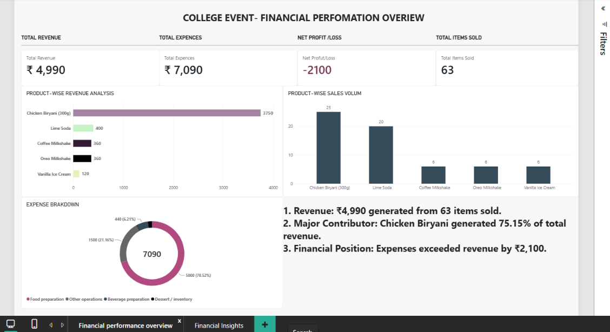

# College Event – Financial Performance Dashboard

## Project Overview
This project analyses the financial performance of a one-day college food stall using Microsoft Power BI.

The dashboard provides insights into sales, revenue, expenses, product performance, and overall financial results.

## Tools Used
- Microsoft Power BI
- Microsoft Excel
- DAX

## Key Performance Indicators
- Total Revenue: ₹4,990
- Total Expenses: ₹7,090
- Net Loss: ₹2,100
- Total Items Sold: 63

## Dashboard Pages
1. Financial Performance Overview
2. Financial Insights

## Key Insights
- Chicken Biryani generated the highest revenue.
- Total expenses exceeded total revenue.
- The event recorded an estimated loss of ₹2,100.
- Expense and revenue contributions were analysed to understand overall performance.

## Note
Some figures are reconstructed estimates based on the information available from the college event. They are intended for portfolio and learning purposes and are not audited financial records.
## Dashboard Preview

### 1. Financial Performance Overview

### 2. Financial Insights

## Project File

[Download Power BI Dashboard](https://github.com/abdulraqeeb-finance/college-event-financial-performance-dashboard/raw/refs/heads/main/College_Event_Financail_Dashbord.pbix)
